# EdgeEver Showcase & Workflows

A curated collection of practical workflows, showcase examples, and real-world scenarios for daily productivity with EdgeEver.

## Table of Contents

### Core Workspace & Focused Writing
- [1. Classic Three-Pane Workspace & Distraction-Free Editing](#1-classic-three-pane-workspace--distraction-free-editing)

### Omnichannel Capture & Ingestion
- [2. One-Click WeChat Chat History Archiving](#2-one-click-wechat-chat-history-archiving)
- [3. One-Click WeChat Article Clipping on Mobile](#3-one-click-wechat-article-clipping-on-mobile)
- [4. One-Click Mobile Image Sharing to Notes](#4-one-click-mobile-image-sharing-to-notes)
- [5. One-Click Xiaohongshu (RED) Note Clipping](#5-one-click-xiaohongshu-red-note-clipping)
- [6. One-Click X (Twitter) Post & Quote Clipping](#6-one-click-x-twitter-post--quote-clipping)
- [7. One-Click Zhihu Answer & Column Article Clipping](#7-one-click-zhihu-answer--column-article-clipping)
- [8. One-Click Reddit Discussion Post Clipping](#8-one-click-reddit-discussion-post-clipping)
- [9. One-Click GitHub Repository Metadata Clipping](#9-one-click-github-repository-metadata-clipping)

### AI-Powered Structuring & Multi-Dimensional Data
- [10. AI Conversational Generation of Mind Maps, Flowcharts & Architecture Diagrams](#10-ai-conversational-generation-of-mind-maps-flowcharts--architecture-diagrams)
- [11. AI-Powered Generation of Professional Infographics](#11-ai-powered-generation-of-professional-infographics)
- [12. Instant Multi-Dimensional Database Table Generation via AI Prompt](#12-instant-multi-dimensional-database-table-generation-via-ai-prompt)
- [13. One-Click Public Online Form Collection from Database Tables](#13-one-click-public-online-form-collection-from-database-tables)
- [14. Connecting Local Agents via ACP for Note Interaction & Co-pilot](#14-connecting-local-agents-via-acp-for-note-interaction--co-pilot)

### Visual Styling & Omnichannel Publishing
- [15. AI RSS Daily Digest & Elegant Image Poster Sharing](#15-ai-rss-daily-digest--elegant-image-poster-sharing)
- [16. One-Click Social Media Poster & Cover Design from Notes](#16-one-click-social-media-poster--cover-design-from-notes)
- [17. One-Click Note Copy to WeChat Official Account & Blogs](#17-one-click-note-copy-to-wechat-official-account--blogs)

---

## Core Workspace & Focused Writing

### 1. Classic Three-Pane Workspace & Distraction-Free Editing

EdgeEver adopts the beloved classic three-pane layout familiar to serious note-takers (Notebook Tree · Note Stream · Editor Canvas):

It delivers the structured clarity of hierarchical notebooks and card feeds, while allowing flexible resizing or one-click sidebar collapse for distraction-free writing. The right-hand editor seamlessly blends WYSIWYG rich text with native Markdown, balancing quick, casual note-taking with deep long-form authoring.

| Classic Three-Pane Workspace Experience (Tree · List · Editor) |
:---:
| 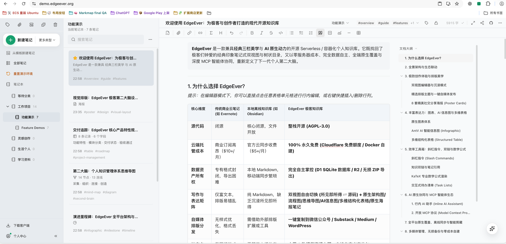 |

---

## Omnichannel Capture & Ingestion

### 2. One-Click WeChat Chat History Archiving

Select multiple messages in WeChat, click "Combine and Forward" (合并转发), and choose **EdgeEver** under "Forward to Other Apps" to instantly convert conversational threads into clean, structured notes.

Senders, timelines, WeChat emojis, and web links are formatted automatically; images are neatly embedded, and documents or multimedia files (e.g., `.xlsx`, `.pdf`, `.mp4`) are preserved as note attachments for full-text search.

| 1. Forward from WeChat to EdgeEver | 2. Structured note generated automatically |
| :---: | :---: |
|  | 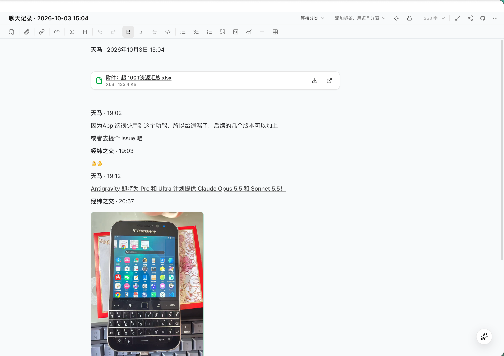 |

---

### 3. One-Click WeChat Article Clipping on Mobile

When reading WeChat Official Account articles on mobile, tap the top-right menu and choose **"Open in EdgeEver"** (用 EdgeEver 打开) to capture the entire article seamlessly.

EdgeEver automatically extracts the full title, structured body, and embedded image assets while stripping web noise and layout clutters, saving it into clean Markdown with `#web-clip` and `#wechat` tags.

| 1. Select "Open in EdgeEver" from WeChat article menu | 2. Automatically launches EdgeEver and extracts content | 3. Clean, beautifully formatted note generated |
| :---: | :---: | :---: |
|  |  |  |

---

### 4. One-Click Mobile Image Sharing to Notes

When browsing social networks or content apps on mobile (such as X / Twitter, Reddit, Instagram, Pixiv, Zhihu, Bilibili, Weibo, etc.) and encountering inspiring images, simply tap the system Share button.

Select **EdgeEver** in the system share sheet. The app opens and uploads original-quality images in the background, generating an independent note titled "Shared Image" ready for notes, tags, and indexing.

| 1. Tap share button on mobile social media app | 2. Choose EdgeEver in system share sheet | 3. Auto-creates note & uploads original image |
| :---: | :---: | :---: |
|  |  | 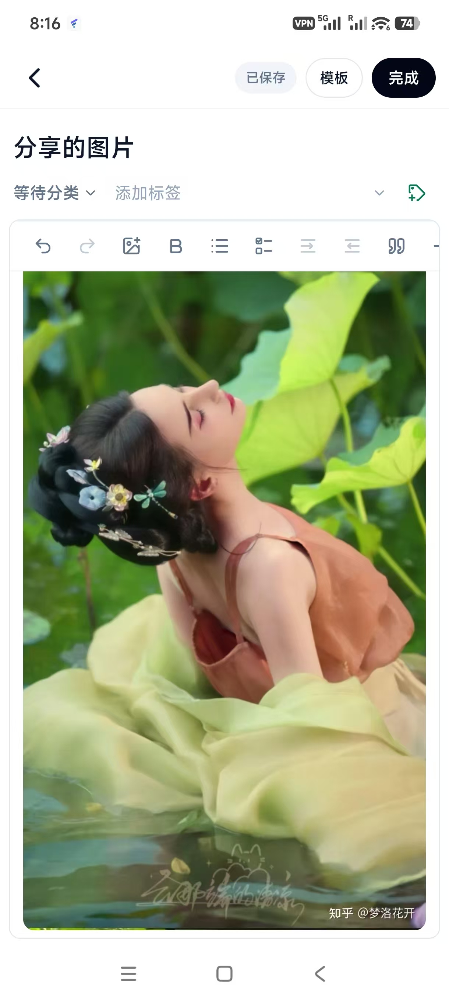 |

---

### 5. One-Click Xiaohongshu (RED) Note Clipping

When browsing Xiaohongshu on the web, use the EdgeEver Web Clipper extension to right-click and select **"Save Note to EdgeEver"** (保存笔记到 EdgeEver) to capture posts instantly.

Post titles, hashtags, body text, publish timestamps, locations, and source URLs are completely retained. High-resolution multi-image galleries are automatically converted into neat multi-column layouts and tagged with `#web-clip` for effortless inspiration retrieval.

| 1. Right-click "Save Note to EdgeEver" | 2. Multi-column gallery note generated |
| :---: | :---: |
| 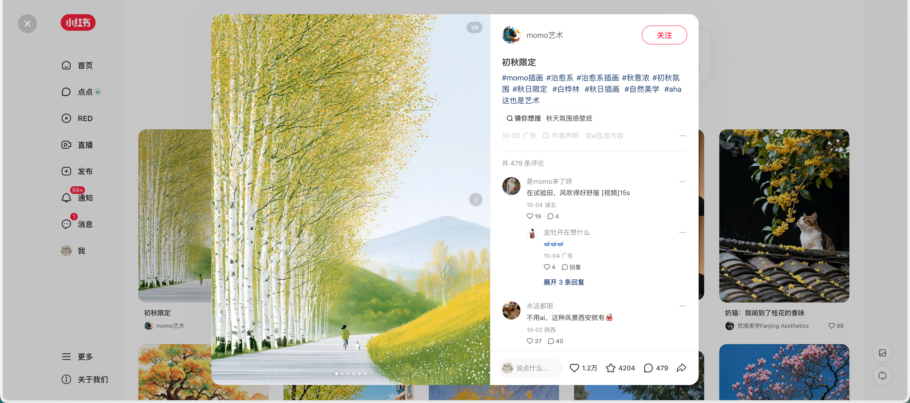 | 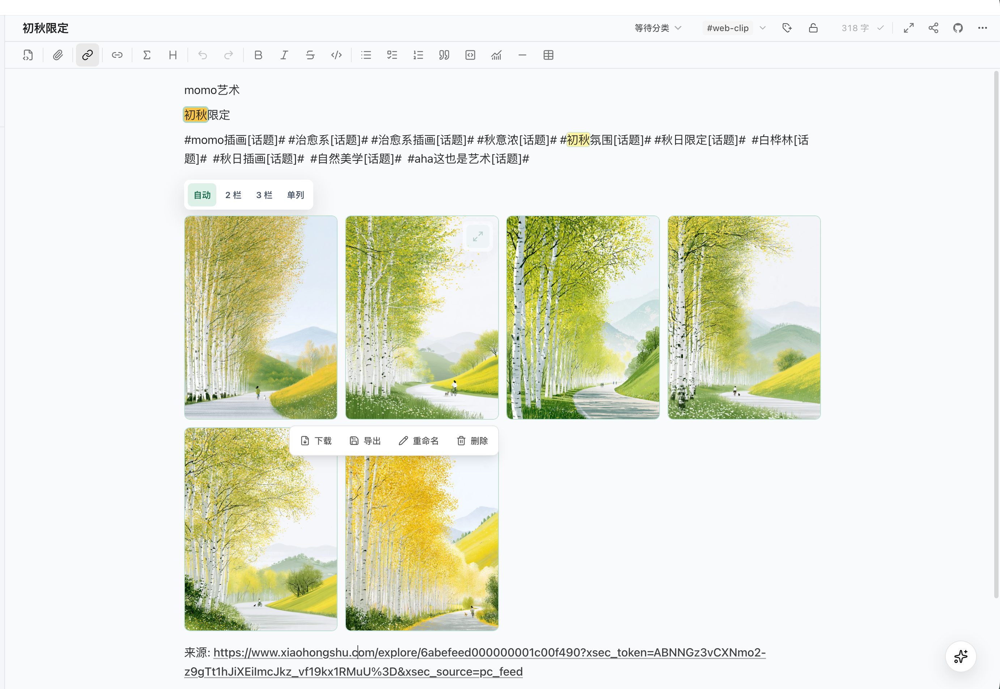 |

---

### 6. One-Click X (Twitter) Post & Quote Clipping

When browsing X (Twitter), use the EdgeEver Web Clipper extension to right-click any post and select **"Save Tweet to EdgeEver"** (保存推文到 EdgeEver) for instant structured capture.

Author metadata, post content, URLs, quote tweets, and high-res multi-image attachments are precisely extracted into clean multi-column layouts and tagged with `#web-clip` for permanent offline knowledge storage.

| 1. Right-click "Save Tweet to EdgeEver" | 2. Post generated with quotes & image galleries |
| :---: | :---: |
|  | 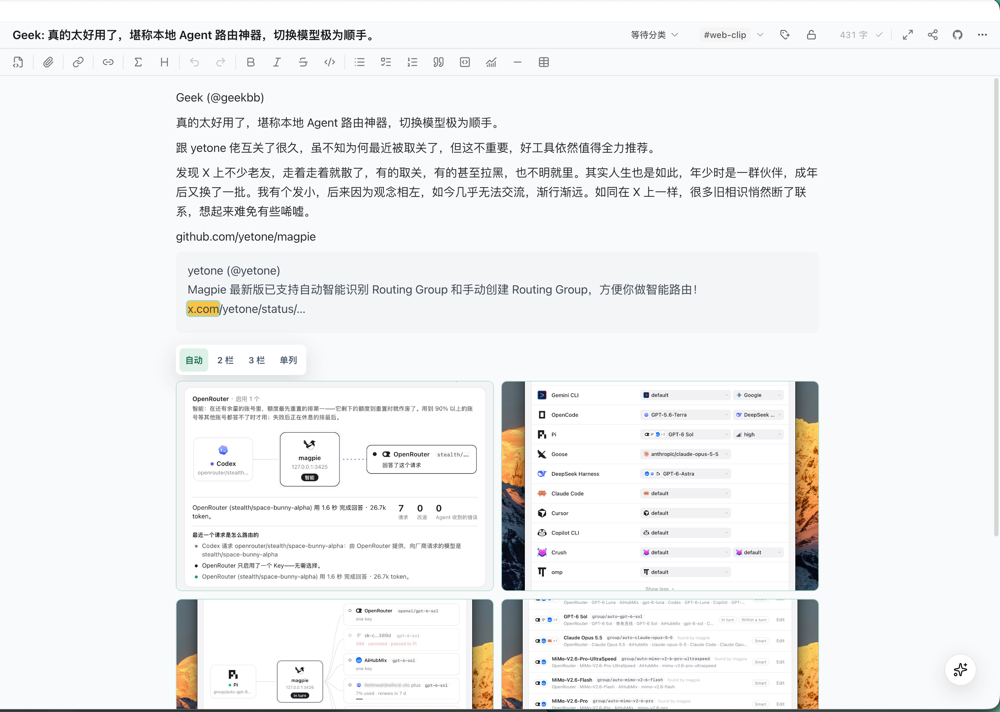 |

---

### 7. One-Click Zhihu Answer & Column Article Clipping

When browsing Zhihu on the web, there is no need to copy messy page layouts manually. Simply right-click on the specific answer or column article and choose **"Save Answer/Article to EdgeEver"** (保存回答/文章到 EdgeEver).

The extension automatically parses the question title, author info, formatted answer body, publish timestamp, and source URL into a clean Q&A layout tagged with `#web-clip`.

| 1. Right-click "Save Answer/Article to EdgeEver" | 2. Clean Q&A structured note generated |
| :---: | :---: |
| 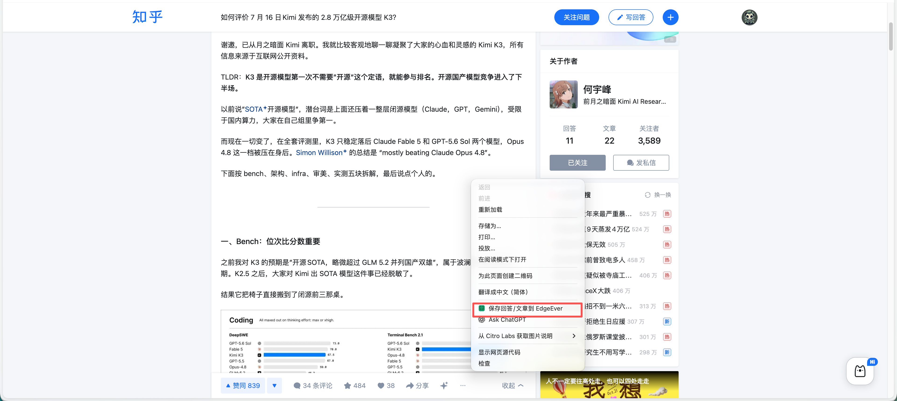 | 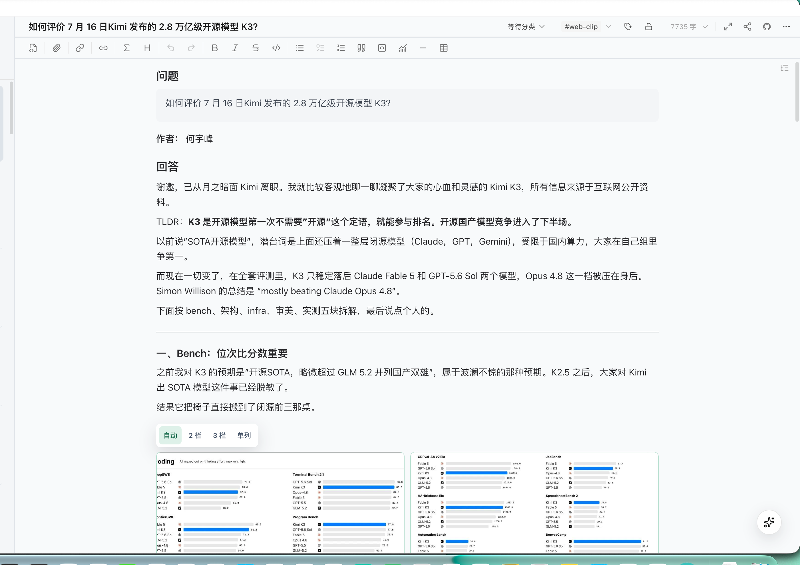 |

---

### 8. One-Click Reddit Discussion Post Clipping

When exploring Reddit discussions, right-click any post title or body text and select **"Save Selection to EdgeEver"** (保存所选内容到 EdgeEver) to archive the thread into an independent note.

The clipper automatically captures the full post title, community/subreddit (e.g. `r/AskReddit`), author handle, post timestamp, fetch time, and original permalink, tagged with `#web-clip` for streamlined personal knowledge review.

| 1. Right-click "Save Selection to EdgeEver" | 2. Post note generated with community & author metadata |
| :---: | :---: |
|  |  |

---

### 9. One-Click GitHub Repository Metadata Clipping

When exploring GitHub repositories on the web, right-click anywhere on a repository page with EdgeEver Web Clipper and select **"Save Repository Info to EdgeEver"** (保存仓库信息到 EdgeEver) to capture structured metadata cards.

Repository names (`Owner/Repo`), project descriptions (About), official websites, primary programming languages, open-source licenses, topic tags, and URLs are neatly parsed and tagged with `#web-clip` for technical research and tool curation.

| 1. Right-click "Save Repository Info to EdgeEver" | 2. Structured repository card note generated |
| :---: | :---: |
|  |  |

---

## AI-Powered Structuring & Multi-Dimensional Data

### 10. AI Conversational Generation of Mind Maps, Flowcharts & Architecture Diagrams

In EdgeEver's right-side AI Co-pilot (or connected local Agent), simply ask using natural language (e.g., "Help me create a mind map / flowchart / architecture diagram about Large Language Models") to generate interactive, editable diagrams right inside your notes.

Diagrams are natively powered by EdgeEver's diagramming engine with intuitive drag-and-drop node editing, auto-layout, bilingual mind maps, condition branches, and system topologies without needing third-party tools.

| 1. Interactive Mind Map via AI Chat | 2. Standard Flowchart via AI Chat | 3. System Architecture Diagram via AI Chat |
| :---: | :---: | :---: |
|  |  |  |

---

### 11. AI-Powered Generation of Professional Infographics

Leverage EdgeEver's built-in infographic templates (including sequential timelines, comparison matrices, list layouts, four quadrants, hierarchical charts, and relation graphs) by prompting the AI Co-pilot with your desired topics.

The AI cross-checks key milestones and facts, generating professionally formatted, visually striking infographic notes in seconds. You can iterate via follow-up prompts or export directly to vector graphics.

| 1. Comprehensive Infographic Template Library | 2. AI-Generated Milestone Timeline Infographic |
| :---: | :---: |
|  |  |

---

### 12. Instant Multi-Dimensional Database Table Generation via AI Prompt

No need to design schemas manually. Send a single prompt in the AI Co-pilot (e.g., "Create a database table for social media content planning" or "Generate an employee onboarding tracker"), and AI will design the full database structure.

Column types (tags, text, dates, links) are inferred automatically and populated with realistic sample data. Supports views, custom filtering/sorting, and CSV export for instant structured collaboration.

| 1. AI Prompt Generates Media Topic Tracker Table | 2. AI Prompt Generates Employee Directory Table |
| :---: | :---: |
|  |  |

---

### 13. One-Click Public Online Form Collection from Database Tables

Click **"Form Collection"** at the top of any EdgeEver database table to transform internal records into a public web form ready for data submission.

Respondents can fill out forms from any desktop or mobile browser without signing in. Form fields, select options, and date pickers stay synchronized with your database schema, streamlining event RSVPs, feedback surveys, and registration workflows.

| 1. Click "Form Collection" in database header | 2. Auto-generated public form submission page |
| :---: | :---: |
| 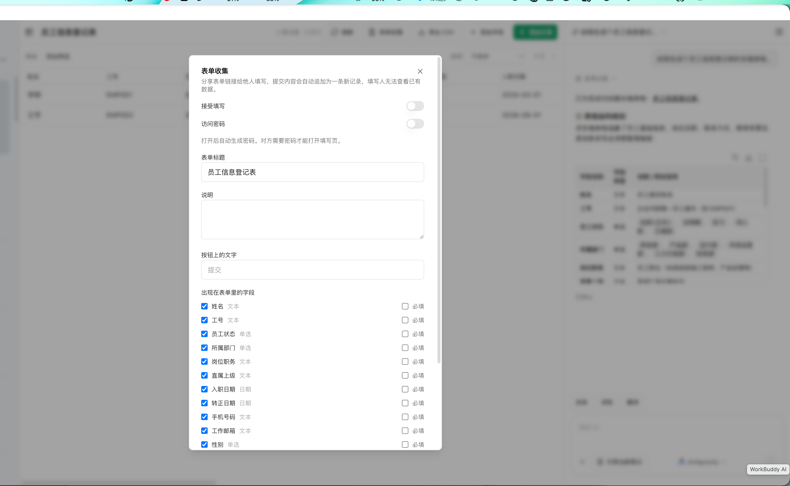 | 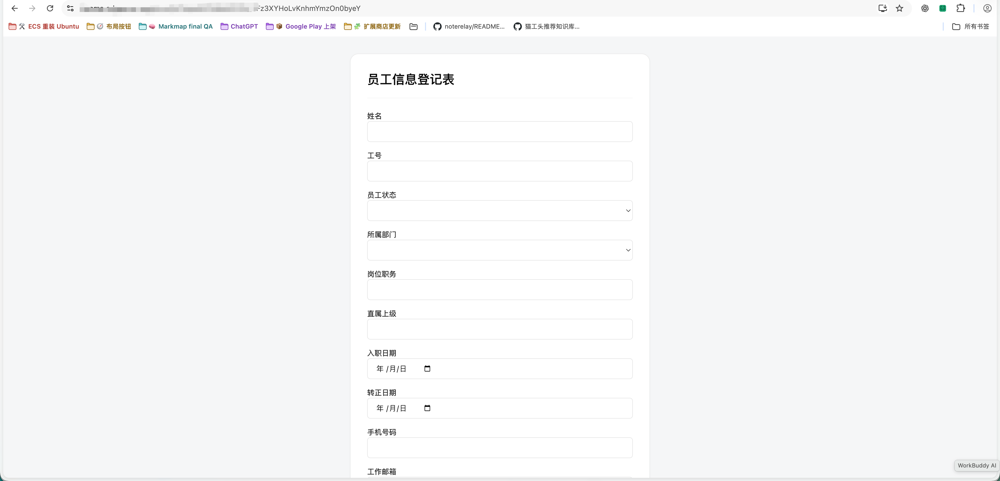 |

---

### 14. Connecting Local Agents via ACP for Note Interaction & Co-pilot

EdgeEver natively embraces the **ACP (Agent Client Protocol)**, allowing desktop clients to bridge local AI agent ecosystems (including Codex, DeepSeek Harness, Claude Code, Antigravity, OpenClaw, WorkBuddy, Hermes Agent, and more).

Once connected via ACP, EdgeEver grants secure read and write permissions to the local Agent. Chat directly with your local Agent from the note sidebar for code reasoning, document synthesis, and multi-step autonomous knowledge base Q&A.

| 1. Connect Local Agents via ACP in Settings | 2. Interactive Note Co-pilot with Local Agent |
| :---: | :---: |
| 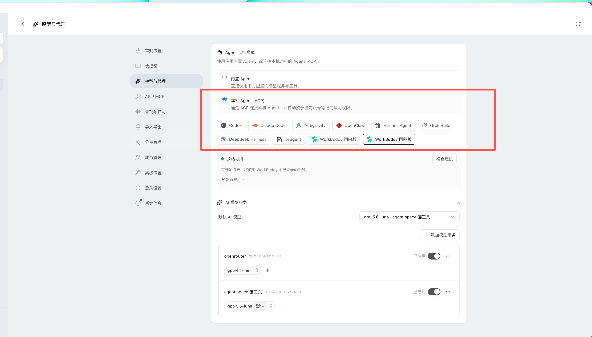 |  |

---

## Visual Styling & Omnichannel Publishing

### 15. AI RSS Daily Digest & Elegant Image Poster Sharing

EdgeEver's built-in AI RSS feeds aggregate industry news, eliminate spam, and generate concise, structured daily digest notes automatically.

Paired with the **"Share as Image"** feature, choose from 8 exquisite poster themes (Book Quote, Memo, Bento, Monochrome, Frame, Code, etc.), adjust serif/monospace typography, card width, and visible fields, then export high-res long images or copy directly to clipboard for social sharing.

| 1. Auto-generated RSS digest & select "Share as Image" | 2. Customize themes, typography & card styles | 3. Exported high-res long poster card |
| :---: | :---: | :---: |
|  |  |  |

For code snippets, tech blogs, and hacker notes, switch to the exclusive **"Code"** theme featuring macOS window controls, line numbers, and monospace syntax highlighting for developer-grade visual cards:

| "Code" Theme Configuration & Live Preview |
| :---: |
|  |

---

### 16. One-Click Social Media Poster & Cover Design from Notes

Click **"Create Poster"** in any note's action menu (or via "New → Poster") to load key takeaways and titles directly into the **EdgeEver Poster Design Studio**.

Equipped with 40+ professional social media poster templates (covering editorial headlines, creator notes, bold punchlines, neon titles, etc.), supporting Xiaohongshu 3:4, Moments, and landscape aspect ratios. Tweak typography, colors, and geometric elements freely, and export high-res PNGs to turn long notes into eye-catching visual cards.

| Load notes into Poster Studio with 40+ professional social templates |
| :---: |
| 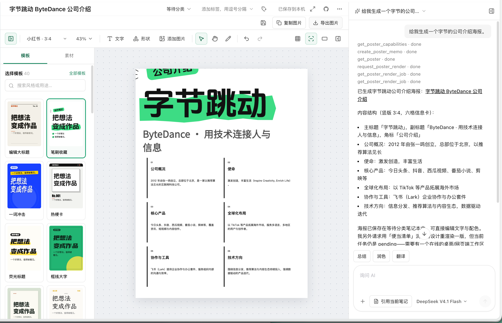 |

---

### 17. One-Click Note Copy to WeChat Official Account & Blogs

In the note list or more actions menu, select **"Copy to Official Account / Blog"** (复制到公众号 / 博客) to convert the entire note into beautifully styled rich text with inline CSS.

Paste directly into the WeChat Official Account article editor: tables, callout blocks, code blocks, lists, and typography styles are preserved flawlessly without requiring external styling tools.

| 1. Click "Copy to Official Account / Blog" in note menu |
| :---: |
|  |

| 2. Pasted into WeChat Official Account editor (full layout with tables, styling & card covers) |
| :---: |
| 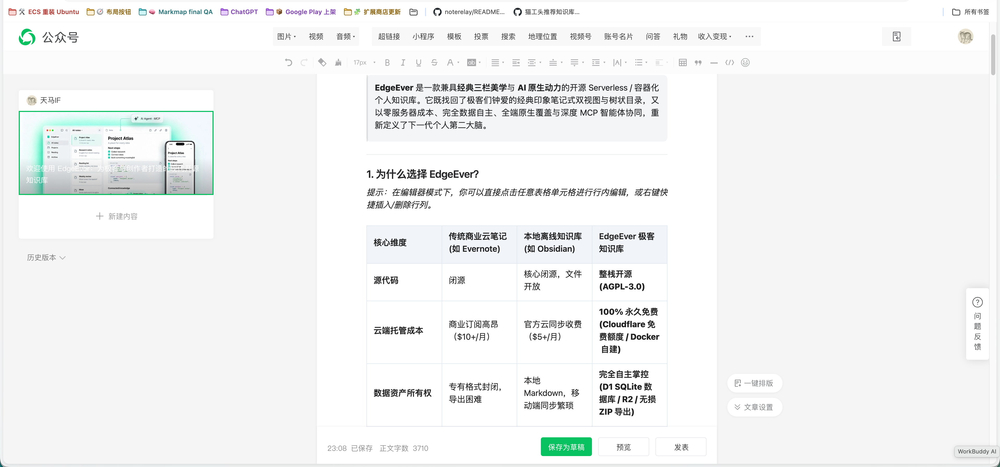 |
